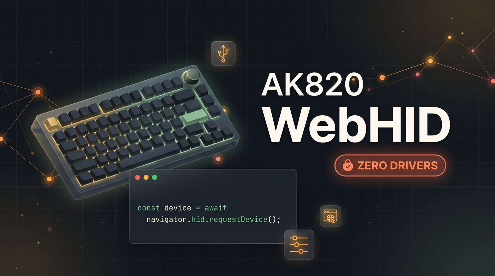

# AK820 Pro WebHID key remapper

[](https://github.com/igordev96/AK820-WebHID/actions/workflows/ci.yml)
[](https://app.netlify.com/sites/ak820-webhid/deploys)
[](https://github.com/igordev96/AK820-WebHID/releases)
[](LICENSE)



An unofficial browser tool for remapping the AJAZZ AK820 Pro. It talks to the keyboard's
configuration interface over WebHID, so there is nothing to install and no admin rights to ask
for. It runs in Chrome, Edge or Opera on desktop.

A hosted copy runs at <https://ak820-webhid.netlify.app/>. It is the same build as this repository.

AK820 Pro is a trademark of its owner. This project is not affiliated with AJAZZ. The tool writes
the key table, so keep the vendor application available for recovery.

## Status

Version 2.0.0 is a Vite, React and TypeScript rewrite of the v1.0.1 single-file app. The key table,
the transfer sequence and the wire bytes are unchanged. The new build has passed tests against a
fake device, and hardware Test 9 passed on 29 Oct 2026: top layer, Fn media override, both restore
actions and the upload lock were checked on the board. The screen clock was added the same day and
confirmed on the board in Test 10, for both this computer's time and a time picked by hand. Test 11
added the screen data channel with one 128 × 128 picture, Test 12 played a 31-frame GIF, and Test 13
played a 60-frame GIF after the 16-bit block count was fixed. Test 14 showed that interrupting an
upload wedges the keyboard until it is unplugged, so the animation card has no cancel.
[docs/02-hardware-tests.md](docs/02-hardware-tests.md) records the evidence.

## What it does

- Remaps any of the 81 keys on the top layer.
- Sets Fn-layer overrides. Keys you leave alone keep the firmware default.
- Assigns consumer keys: mute, volume, play/pause, track skip, browser back and forward,
  calculator and email.
- Sets the clock on the keyboard's screen, from this computer or from a time you pick.
- Plays a GIF on the screen, up to 140 frames, or one still picture.
- Restores the factory top map or clears every Fn override.
- Runs diagnostics, a deep probe, a mailbox probe and raw test commands from the Advanced drawer.

Top-layer and Fn-layer remapping and both restore actions were tested on an AK820 Pro (VID `0C45`,
PID `8009`) with the v1 app. The v2 build repeated the top-layer write and restore, wrote and
cleared an Fn media override with persistence across a reload, ran both restore actions and held
the upload lock, on 29 Oct 2026. Media testing covered Mute, Volume up and Volume down. The other
consumer functions use the same record format but were not each tested.

## Supported devices

VID `0C45` with PID `8009` (tested), `800A` or `FDFD`. Only the `8009` board has been used on
hardware. Other AK820 variants may share the protocol, but they have not been tested.

## What it cannot do

The firmware has no read-back command, so the app cannot show the layout stored on the keyboard.
It assumes the top layer is factory and treats an all-zero Fn table as the default. Fn overrides
are saved in this browser.

The screen is write-only too: the page cannot read the clock or anything else the screen holds.
The clock has no timezone, so it stays on the wall-clock time you sent.

The knob is input-only, so it cannot be remapped. Bluetooth mode does not expose the
configuration interface.

## Requirements

- Chrome, Edge or Opera on desktop. Firefox, Safari and mobile browsers do not support WebHID.
- A USB connection. Bluetooth mode does not expose the interface.
- Close the AJAZZ desktop app while this page is connected.
- Serve the page from `http://localhost` or HTTPS. WebHID needs a secure context.

## Quick start

```bat
npm install
npm run dev
```

Open <http://localhost:5173/>, click **Connect keyboard** and choose the AK820 in the browser
chooser. Pick a key, choose a function, then click **Upload changes**.

To try the production build:

```bat
npm run build
npm run preview
```

`dist/` holds the deployable files. It is never committed.

## Using the editor

The top layer is the table the keyboard types without Fn. Click a key, choose the new function
under **Sends**, then upload. Every upload sends the full 576-byte table because the firmware has
no single-key command.

The Fn layer tab edits what each key does while Fn is held. Only the keys you change are written;
every other slot stays zero, which means the firmware handles that combination. Six keys marked
`fnlayer_disable` by the vendor layout are read-only there.

The Media group assigns consumer functions. Their records use a different type, and the raw box
shows the `c:` prefix, for example `c:0xE2` for Mute. The prefix is required because `0xE2` is
also keyboard Left Alt.

**Reset this key** restores one top-layer key. **Restore factory map** rewrites the whole top
layer. On the Fn layer, **Back to firmware default** clears one override and **Clear all Fn
overrides** clears the layer.

### The screen clock

**Screen** opens the clock view. **Now** sends this computer's local time; **Custom** takes a date
and time you pick. One write sets the screen clock, and no key mapping is touched.

The keyboard has no timezone, so the clock follows the time you send. A daylight saving change
later in the year will not move it. The page never sets the clock on connect; you press **Send
time** when you want it.

### The screen animation

**Screen animation** takes a GIF, or one still picture, and plays it on the screen. Frames are
scaled to 128 × 128 in the browser and sent with their own delays, clamped to 30–500 ms. The
keyboard holds at most 140 frames; longer GIFs use the first 140 and the card says so.

The upload takes about 50 seconds for 30 frames and about four minutes for 140, so the card shows a
progress bar. A picture never leaves the page.

Let an upload finish. The keyboard is busy until the commit, and interrupting one leaves the screen
stuck on its loading indicator until you unplug the keyboard; the frames already sent stay on the
screen after the replug. There is no safe cancel for this channel.

This replaces the animation on the keyboard, which this tool cannot read back. The vendor app can
put the stock animation back.

**Advanced** opens the diagnostics, the deep probe, the mailbox probe and a raw command card.
These send test commands and never write a keymap. Uploads are locked while one of them runs.

## The missing read-back

If you remapped keys in the vendor app, this app cannot see that layout. Uploading the factory map
will overwrite it. Restore the vendor app's defaults first if you need to keep it.

Fn overrides are stored in `localStorage` under `ak820.fn.overrides` in this browser profile.
Clearing site data forgets them. They do not travel to another browser or machine.

## Recovery

Undo a single change with **Reset this key** on the top layer or **Back to firmware default** on
the Fn layer, then upload.

Undo a whole layer with **Restore factory map** or **Clear all Fn overrides**.

If the screen clock drifts, send it again from **Screen**. Opening the vendor app also sets the
clock, because it does that whenever it starts with the keyboard connected.

If you interrupt a screen upload, unplug the keyboard and plug it back in. The screen may show a mix
of the old and new animation; send the animation again to replace it.

If you want the stock animation back, import the vendor's `0.gif` in the vendor app and upload it
there. This tool cannot read what is on the screen, so it cannot save the current animation for
you.

If the app refuses a transfer, it stops before staging data, so the keyboard is unchanged. Unplug
and replug the keyboard, then try again. Close any other program that may hold the interface.

If the keyboard stops responding or types the wrong keys, unplug and replug it, upload the factory
map again, or use the vendor application's restore function.

Do not start two uploads at once. The app locks the editor during a transfer; leave that lock in
place.

## Privacy

The page makes no analytics, telemetry or external asset requests. Fonts are self-hosted. The only
stored data is the Fn overrides in `localStorage` under `ak820.fn.overrides`.

## Development

Node.js 22.12 or newer is required for development and the build. Node 24 is recommended.

```bat
npm install
npm run verify
```

`npm run verify` runs the typecheck, the linter, the format check, the Vitest suite and the
production build. All five must pass before a commit.

GitHub Actions runs the same command on every push to `main` and every pull request. The workflow
is `.github/workflows/ci.yml`.

`src/lib/keymap` and `src/lib/hid` import no React. Components live in `src/features` and call
those modules or the editor state. HID tests use a fake device, so the suite runs without a
keyboard. [docs/04-code-map.md](docs/04-code-map.md) maps the modules and the tests.

## Deployment

`netlify.toml` runs `npm run build` on Node 24 and publishes `dist/`. There are no redirects or
server functions. WebHID permission belongs to the origin, so the localhost and deployed origins
keep separate device permissions. The public site is <https://ak820-webhid.netlify.app/>, deployed
from `main`. Netlify builds each push to `main`; the deploy badge in the README reports the latest
build.

## Documentation

The full reading order is in [docs/README.md](docs/README.md).

| Page | Contents |
|---|---|
| [docs/01-protocol.md](docs/01-protocol.md) | device, report framing, mailbox, table format, layers |
| [docs/02-hardware-tests.md](docs/02-hardware-tests.md) | hardware runs and what they proved |
| [docs/03-media-keys.md](docs/03-media-keys.md) | consumer records and the explicit page marker |
| [docs/04-code-map.md](docs/04-code-map.md) | module map, state flow and test layout |
| [docs/05-setup.md](docs/05-setup.md) | setup, checks, deployment and troubleshooting |
| [docs/06-history.md](docs/06-history.md) | decisions, dead ends and lessons |
| [docs/key-index-table.md](docs/key-index-table.md) | key index, usage, Fn lock and geometry |

The protocol notes were written for interoperability. Vendor binaries, layout XML, artwork and
the installer are not distributed here. A few documents mention the private research material
they were derived from.

## License

MIT. See [LICENSE](LICENSE). The documentation uses the same license.
